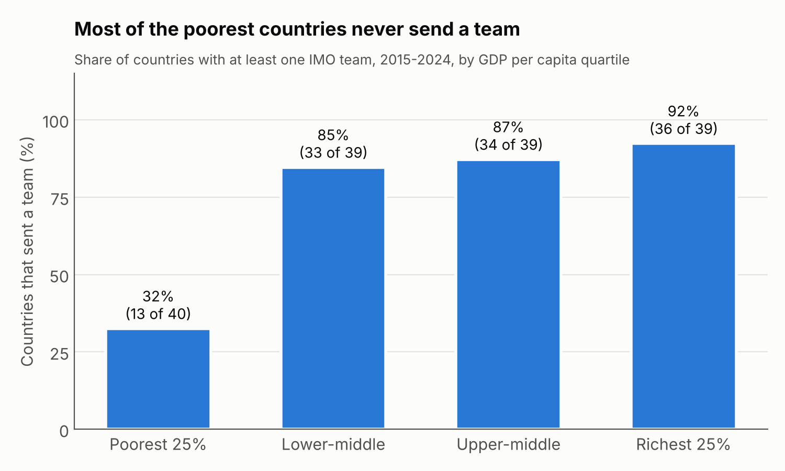
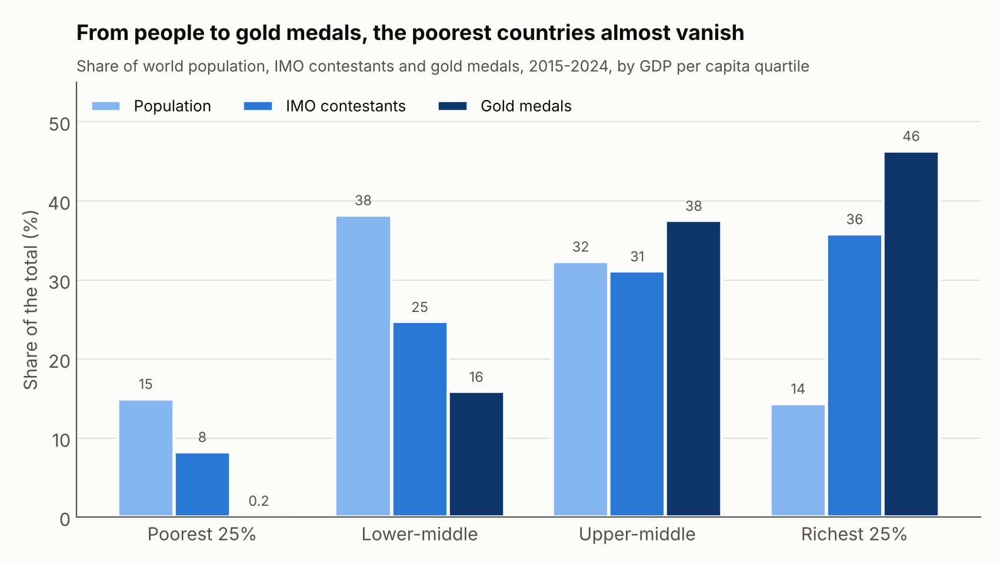
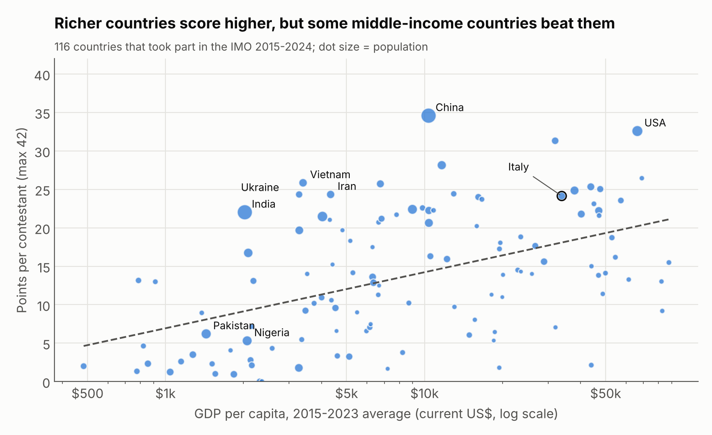

# Lost talent: who gets to compete at the International Mathematical Olympiad?

In 1913 Srinivasa Ramanujan, a self-taught clerk in Madras, wrote to three mathematicians in Cambridge. Two did not take him seriously. The third, G. H. Hardy, read the letter properly and brought him to England, where he became one of the greatest mathematicians in history. Without that one reply, nobody would know his name.

**How many Ramanujans never get their letter read?** This project is a first, simple look at that question. It uses the International Mathematical Olympiad (IMO), the world championship of mathematics for secondary-school students, as a window on where mathematical talent gets seen, and where it does not.

## Key findings (IMO 2015-2024, 157 countries with at least 1 million people)

1. **Most of the poorest countries never compete.** Only 13 of the 40 poorest countries (32%) sent a team in the last ten years, against 85-92% in every other income group.
2. **From people to gold medals, the poorest countries almost vanish.** The poorest quarter of countries holds 15% of the world's population and 8% of IMO contestants, but won 0.2% of gold medals: 1 out of more than 450.
3. **Income matters, but it is not destiny.** Among participating countries, a tenfold increase in GDP per capita goes with about 8.6 more points per contestant (out of 42), holding population constant. Yet Mongolia, Armenia, Ukraine, Vietnam and Iran score 9 to 14 points above what their income and size would predict. Several of them have a long tradition of specialised maths schools, which suggests that how a country finds and trains talent can matter as much as how rich it is.







Full numbers: [results/results.md](results/results.md). The direction of the main findings (participation gap, medal gap, income gradient) holds under different choices of period, population threshold and definition of taking part, though the size of the gaps changes: see [results/robustness.md](results/robustness.md).

## Data and method

| Source | What | Period |
| --- | --- | --- |
| [IMO results by country](https://github.com/rfordatascience/tidytuesday/tree/main/data/2024/2024-09-24) (TidyTuesday, from imo-official.org) | Team size, points per problem, medals | 2015-2024 |
| [GDP, current US$](https://github.com/datasets/gdp) (World Bank) | GDP by country and year | 2015-2023 average |
| [Population](https://github.com/datasets/population) (World Bank) | Population by country and year | 2015-2023 average |

- Countries are grouped into four quartiles of GDP per capita.
- *Points per contestant* = all points scored by a country's team over the period divided by the number of contestants it sent (maximum 42).
- The regression of points per contestant on log GDP per capita and log population uses OLS with heteroskedasticity-robust (HC1) standard errors.

## Limitations

- **Correlation, not causation.** Income stands in for many things at once: schools, training programmes, travel funding, national math olympiad institutions.
- **Teams are capped at six students**, so large countries are under-represented relative to their population. The gap between contestant share and gold share (8% vs 0.2% for the poorest countries) is not affected by the cap.
- **Country level, not individual level.** The data say nothing about what happens to talented students who never reach the IMO, which is the real question.
- **Choices matter for the size of the gaps.** Including countries under 1 million people raises the poorest group's gold share from 0.2% to 2.4% (see the robustness checks).
- 18 contestants competed without a country at IMO 2022-2024 (12 gold medals) and are not in the country data; counting their medals in the total would leave the poorest group's gold share at 0.2%.
- GDP per capita is in current US$, not purchasing-power parity. Taiwan, North Korea and Venezuela drop out because World Bank income data are missing.

## Next steps

- **Individual careers:** follow IMO participants over time, as [Agarwal & Gaule (2020)](https://www.aeaweb.org/doi/10.1257/aeri.20190457) do, who find that equally talented participants from poorer countries produce far less research later in life.
- **Lost talent in Italy:** use INVALSI test data and its socio-economic index (ESCS) to ask whether top-performing students from disadvantaged families choose science-oriented upper-secondary schools and universities less often.
- **Who notices talent?** A vignette experiment with teachers: the same brilliant student profile, varying only family background, to see whether talent is recognised differently.

## How to run

```bash
pip install -r requirements.txt
python src/prepare_data.py   # builds data/processed/country_panel.csv
python src/analysis.py       # writes figures/ and results/results.md
python src/robustness.py     # writes results/robustness.md
```

## Repository structure

```
data/raw/          original data files
data/processed/    country-level panel built by prepare_data.py
src/               data preparation and analysis scripts
figures/           charts used in this README
results/           key numbers in tables
```

## Author

**Lorenzo Landucci**, MSc Clinical Psychology (University of Florence), BSc Economics (University of Pisa). Research question and study design by the author; code written with the help of an AI coding assistant (Claude, Anthropic) and reviewed by the author.

## References

- Agarwal, R. & Gaule, P. (2020). Invisible Geniuses: Could the Knowledge Frontier Advance Faster? *American Economic Review: Insights*, 2(4), 409-424.
- Bell, A., Chetty, R., Jaravel, X., Petkova, N. & Van Reenen, J. (2019). Who Becomes an Inventor in America? The Importance of Exposure to Innovation. *Quarterly Journal of Economics*, 134(2).
- Kanigel, R. (1991). *The Man Who Knew Infinity: A Life of the Genius Ramanujan*. Scribner.
